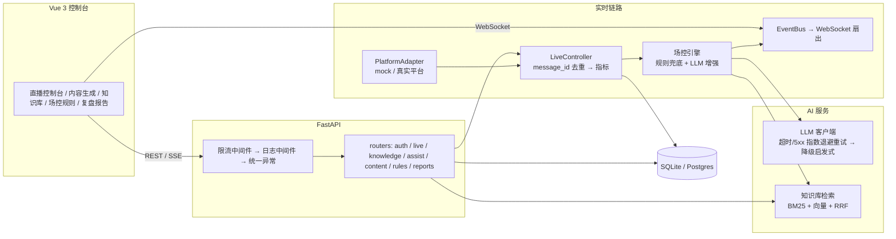

# LivePilot · 直播 AI 运营中台

面向主播和 MCN 的实时 AI 运营工具，覆盖「实时场控 + 话术辅助 + 数据复盘」完整闭环。
本项目是可运行、可演示的全栈 MVP，后端无外部服务也能跑通（LLM 与直播源都有内置降级）。

## 功能

- **实时场控**：WebSocket 实时接入弹幕/礼物/进场事件，规则引擎 + LLM 意图情绪识别，
  自动生成回复、欢迎、告警与升级动作，支持人工确认/驳回。
- **话术库与播放队列**：持久化可循环口播的话术（启用开关 + 播放次数加权 + 避免短期重复），
  两级优先级队列在无人互动时自动补位话术，弹幕/礼物/进场回复以高优先级插入。
- **场控规则**：礼物阈值、VIP 欢迎等级、敏感词与动作开关均可在线配置，
  RBAC 控制写入，保存后实时生效。
- **内容生成**：一键生成直播标题、开场/逼单话术、答疑话术与商品口播脚本，
  结合知识库上下文与文案风格，SSE 流式输出。
- **话术助手**：知识库混合检索（BM25 稀疏 + 可选向量稠密 + RRF 融合）+
  实时弹幕上下文，SSE 流式生成主播可直接口播的话术。
- **数据复盘**：聚合一场直播的指标（弹幕、礼物、情绪、高频提问），并基于 events 表生成
  分钟级节奏时间序列与峰值/冷场/高光检测，前端趋势图可视化，报告文字引用具体时间点，自动生成可执行建议。
- **工程底座**：JWT 鉴权 + 多租户 RBAC、结构化日志、统一异常处理、接口限流（滑动窗口 +
  登录防爆破）、写接口幂等（Idempotency-Key）、事件 message_id 去重、LLM 指数退避重试。

## 技术栈

- 前端：Vue 3 + TypeScript + Vite + Vue Router + `@lucide/vue`
- 后端：FastAPI + Python 3.11+ + SQLite（可切换 Postgres）+ WebSocket + SSE
- AI：OpenAI 兼容接口 + function calling，无 Key 时自动降级到内置启发式引擎

## 快速开始

后端（默认 `http://127.0.0.1:8000`）：

```bash
cd backend
python -m pip install -r requirements.txt
python -m uvicorn app.main:app --reload
```

前端（默认 `http://127.0.0.1:5173`）：

```bash
cd frontend
npm install
npm run dev
```

打开 `http://127.0.0.1:5173`，用演示账号登录后进入「直播控制台」点「开始直播」。

## 演示账号

| 账号 | 密码 | 角色 |
| --- | --- | --- |
| `admin` | `admin123` | 管理员 |
| `host` | `host123` | 主播 |
| `operator` | `op123` | 场控 |

## 接入真实 LLM

复制 `backend/.env.example` 为环境变量，设置：

```text
LLM_API_KEY=sk-...
LLM_BASE_URL=https://api.openai.com/v1
LLM_MODEL=gpt-4o-mini
LLM_EMBEDDING_MODEL=text-embedding-3-small
# 可选：向量接口单独配置（留空则复用上面的对话接口）
LLM_EMBEDDING_BASE_URL=
LLM_EMBEDDING_API_KEY=
```

不设置 Key 时，分类、话术与复盘都由内置启发式引擎生成，检索退化为纯 BM25，
保证离线可演示。设置 `LLM_API_KEY` 后，知识库写入与检索会额外启用
`LLM_EMBEDDING_MODEL` 的稠密向量，并通过 RRF 与 BM25 融合。

### 本地 Ollama

Ollama 提供 OpenAI 兼容接口，**无需 API Key**（接口地址为本机时自动跳过鉴权）：

```text
LLM_BASE_URL=http://localhost:11434/v1
LLM_MODEL=qwen2.5:7b
LLM_EMBEDDING_MODEL=nomic-embed-text
LLM_API_KEY=          # 留空即可
```

先执行 `ollama serve`，并 `ollama pull qwen2.5:7b`、`ollama pull nomic-embed-text`。
也可以在「系统设置 → LLM 接入」里填同样的值（接口地址、模型、Key 留空）。

**对话与向量可分开不同接口**：例如对话走云端 OpenAI、向量走本地 Ollama，
把「向量接口地址」填 `http://localhost:11434/v1`、向量模型填
`nomic-embed-text` 即可，两者互不影响；留空时自动复用对话配置。

### AI 整理知识库

零散规则（商品说明、价格表、售后政策等）可以直接粘到「知识库 → AI 批量整理」，
由 LLM 拆成多条原子化、带口语标签的结构化条目，预览勾选后一键入库；
也支持读取 txt / csv / md 文件。单条「新增知识」表单里还有「AI 补全标签」，
只填内容即可让模型补标题、分类与问法标签。未配置模型时自动退化为按段落拆分，
功能始终可用。提示：本地 Ollama 模型冷启动（如 8B）首次整理可能需 1–3 分钟，
建议先 `ollama run <模型>` 保持模型常驻。

## 架构



关键链路与设计取舍：

- **事件管道**：适配器产出归一化事件 → `message_id` 去重（断线重连重放不重复落库）
  → 场控引擎（规则先发、LLM 异步增强、失败降级启发式）→ SQLite 落库 → EventBus
  扇出到 WebSocket 观众端；慢消费者丢帧不阻塞生产者。
- **可靠性**：写接口（开直播 / 停播 / 知识库 / 规则）支持 `Idempotency-Key`，
  重试方重放拿到首次响应；并发重复请求返回 409，同 Key 换请求体返回 422。
- **限流**：全局 API 240 req/min/客户端，登录 10 req/min/客户端（PBKDF2 120k 迭代
  拉高爆破成本），超限返回 429 + `Retry-After`；内存实现面向单进程，多实例部署将
  同一接口换成 Redis 即可。
- **LLM 成本与可用性**：可重试错误（超时/连接/5xx/429）指数退避重试 3 次，
  4xx 不重试；全部失败后降级启发式，离线可演示。

## 压测结果

自包含压测（`scripts/load_test.py`，ASGI 内嵌、独立临时库、无 LLM Key 的规则兜底链路）：

| 场景 | 吞吐 | p50 | p95 | p99 |
| --- | --- | --- | --- | --- |
| 场控引擎内核（3000 事件） | 275,866 events/min | 0.3ms | 0.5ms | 0.7ms |
| 端到端管道（3000 事件，零丢失） | 9,913 events/min | - | - | - |
| HTTP API 混合读写（并发 20） | 514 RPS | - | 读 43.5ms | 读 55.9ms |

验收线：1000 events/min（实测约 10 倍）、弹幕到动作 < 1s（引擎 p95 0.5ms）。
完整报告见 `docs/load-test-report.md`，可用 `python scripts/load_test.py` 复现。

## 项目结构

```text
backend/
  app/
    main.py          FastAPI 入口与中间件（限流 → 日志 → 统一异常）
    controller.py    直播会话编排（事件循环、去重、持久化、扇出）
    engine.py        场控引擎（规则 + LLM）
    platform.py      平台适配层（mock / 抖音直连 / 抖音工具 / 视频号回调）
    douyin_direct.py 抖音直连协议（ttwid/webid/X-Bogus/wss + protobuf 解码）
    knowledge.py     商品知识库与检索
    retriever.py     BM25 / 余弦 / RRF 混合检索
    rules.py         场控规则持久化与校验
    content.py       内容生成服务
    script_manager.py 话术库与加权选取
    play_queue.py     两级优先级播放队列
    replay.py        指标聚合与复盘生成
    llm.py           LLM 客户端（指数退避重试 + 降级）
    runtime_config.py  运行时配置（DB 覆盖 env，admin 可视化管理）
    ratelimit.py     滑动窗口限流器
    idempotency.py   Idempotency-Key 幂等支持
    routers/         auth / live / knowledge / assist / content / rules / scripts / reports / ingest / admin
  scripts/smoke_test.py   端到端冒烟测试
  scripts/queue_smoke.py  话术队列端到端验证
  scripts/feed_events.py  模拟抓流工具（真实闭环自测）
  scripts/load_test.py    自包含压测（引擎 / 管道 / HTTP API）
  tests/              单元测试（retriever / security / llm / ratelimit / idempotency）
frontend/
  src/views/         登录 / 直播控制台 / 内容生成 / 知识库 / 话术库 / 场控规则 / 复盘报告 / 系统设置 / 权限管理
  src/components/    指标卡、实时流式面积图、侧边栏
docs/                压测报告
```

## 验证

```bash
cd frontend && npm run typecheck && npm run build
cd backend && python scripts/smoke_test.py
cd backend && python scripts/retrieval_eval.py
cd backend && python -m unittest discover -s tests -t .
cd backend && python scripts/queue_smoke.py
cd backend && python scripts/load_test.py --out ../docs/load-test-report.md
```

> 注意：单测命令必须带 `-t .`。不带时模块以顶层名加载，`tests/__init__.py`
> 的一次性数据库隔离不生效，测试会写入演示库 `data/livepilot.db`。

## 真实平台接入（抖音 / 视频号）

直播控制台的「开始直播」支持四类事件源：内置模拟数据、抖音直播（直连）、
抖音（外部工具）、视频号直播。所有来源归一化为 `LiveEvent`，业务层
（规则引擎 / LLM / 落库 / WebSocket 扇出）对事件来源无感知。

### 抖音直播（直连，推荐）

无需任何外部工具：`DouyinDirectAdapter` 内置了完整的抖音网页版弹幕协议，
填直播间号即可拉取真实弹幕。

1. 控制台选择「抖音直播（直连）」，直播间号支持四种填法（任选其一）：
   - **web_rid**：直播间链接 `https://live.douyin.com/<web_rid>` 的尾号，
     纯数字或字母数字，如 `856477039359`、`KXyy12345678`；
   - **完整直播间链接**：`https://live.douyin.com/856477039359?...`；
   - **抖音分享短链**：`https://v.douyin.com/xxxxxx/`，适配器会跟随跳转、
     从落地页自动解析出 web_rid；
   - **整段分享文案**：从抖音 App「分享 → 复制链接」直接粘贴，
     带 `#在抖音，记录美好生活#` 等前后文字也可以，会自动提取其中的链接；
2. 开播后适配器自动完成：匿名 `ttwid` cookie 获取 → `webid` 设备注册 →
   房间号解析（web_rid → 真实 room_id）→ X-Bogus 签名 → 建立 wss 弹幕流；
3. 协议为手写 protobuf 编解码（PushFrame → Response → Message），带 10s
   心跳与游标 ack；厂商 msgId 归一化为 `message_id`（`dy:<id>`），断线按
   1s→30s 指数退避重连，重放消息由会话级去重窗口吸收；
4. 依赖：本机需安装 Node.js（X-Bogus 签名走 `backend/scripts/sign_runner.js`，
   签名组件随仓库提供，`npm install` 已含）。

映射关系（来自对头部主播直播间的真实抓包验证）：弹幕/语音弹幕/表情弹幕 →
`chat`、点赞 → `like`、进场 → `user_enter`、关注 → `follow`、轻量礼物/
正式礼物 → `gift`；在线人数按进场/关注事件累计（与 mock 源口径一致）。

### 抖音（DouyinBarrageGrab 外部工具模式）

1. 本机运行 [DouyinBarrageGrab](https://github.com/ape-byte/DouyinBarrageGrab)，
   浏览器打开目标直播间页面（工具自动 hook 并解码直播 protobuf 协议）；
2. 工具默认在 `ws://127.0.0.1:8888` 以 JSON 广播弹幕/进场/关注/礼物事件，
   可用环境变量 `DOUYIN_WS_URL` 覆盖；
3. 控制台选择「抖音（外部工具）」开播，`DouyinAdapter` 作为 WebSocket 客户端
   接入，断线按 1s→30s 指数退避重连；兼容工具的 PascalCase（老版）与
   camelCase（新版）两种消息格式。

### 视频号（wxlivespy 回调）

1. 本机运行 [wxlivespy](https://github.com/fire4nt/wxlivespy)，登录视频号直播后台；
2. 将其事件转发地址指向本服务 `http://127.0.0.1:8000/api/ingest/wxlive`；
3. 控制台选择「视频号直播」开播，wxlivespy 推送的事件经 webhook 进入对应会话
   的事件队列；厂商 `seq` 归一化为 `message_id`，重放消息由会话级去重窗口吸收；
4. 生产部署请设置 `WXLIVE_INGEST_TOKEN`，wxlivespy 请求头带
   `X-Ingest-Token` 同值；webhook 路径不受接口限流约束（机器对机器、令牌鉴权）。

> 合规提示：两家平台均未提供公开的第三方弹幕接口，直连协议与上述工具均为
> 个人学习用途的抓取/自动化方案，商用需平台官方授权，请自行评估合规风险。

### 房间号与闭环验证

- **抖音直连**：直播间号必填（web_rid 或完整链接），房间号无法解析时
  适配器会重试并在日志中说明原因；
- **抖音外部工具模式**：开播时填「房间 GroupId」按广播过滤（选填）；
- **视频号**：无房间概念，字段仅作备注。
- 不依赖真实直播间时，可用 `scripts/feed_events.py` 冒充工具输出，真实走完
  外部工具模式的适配器代码路径（WS 客户端拉流 / webhook 解析 → 归一化 →
  去重 → 引擎 → 落库 → WebSocket 推送）：

```bash
# 终端 1：模拟 DouyinBarrageGrab 广播（随后在控制台选「抖音（外部工具）」，房间填 123456）
python scripts/feed_events.py douyin --room 123456 --n 200 --interval 0.1

# 或：模拟 wxlivespy 推送（先在控制台以「视频号直播」开播）
python scripts/feed_events.py wxlive --n 20 --interval 0.2
```

## LLM 可视化配置（管理员）

侧边栏「系统设置」（仅 admin 可见）分两个页签：

- **LLM 接入**：配置 OpenAI 兼容接口（API Key、接口地址、对话/向量模型），
  存数据库并在保存后立即生效，优先级高于环境变量；API Key 仅以掩码回显，
  连通性一键测试（同时测试对话与向量）。向量接口可单独填地址与 Key，
  留空则复用对话配置；接口地址指向本机时（Ollama 等）可留空 Key。
  未配置 Key 时系统以离线启发式模式运行，全部功能可演示。
- **AI 风格**：人设驱动的系统提示词——主播名称、性格特点、说话风格、知识
  范围、禁止话题，表单下方实时预览最终 System Prompt。人设作为前缀注入
  话术助手（SSE）、内容生成、复盘报告三类生成场景；弹幕意图分类为结构化
  任务不受影响。

## 权限管理（管理员）

侧边栏「权限管理」管理系统成员：新建用户（指定角色）、行内切换角色
（管理员/主播/场控）、重置密码、删除用户。内置防呆：不能修改自己的角色、
不能删除自己、系统至少保留一名管理员；接口层非 admin 一律 403。

## 话术库与播放队列

侧边栏「话术库」沉淀可循环口播的话术（标题、内容、文字/音频类型、标签、
启用开关）。开播后后端为每场直播创建两级优先级队列：

- **高优队列**：主播在「直播控制台」确认执行的自动回复/进场欢迎，作为弹幕
  回复、礼物感谢等即时口播插入队首，优先播报；
- **低优队列**：无人互动时按「播放次数越少越优先、最近播过暂不重复」的策略
  从话术库自动补位，保证随时有下一句可播；
- 控制台实时展示「下一条口播」与高优/补位数量，主播点击「已播」即弹出并广播
  队列变更；话术的播放次数会回写，反向影响后续补位的加权。

该设计借鉴了 LiveStream（数字人直播）的 PlayQueue + ScriptManager 思路，
但把「决定说什么」与「驱动数字人/TTS 播报」解耦：当前 MVP 以人工确认 + 队列
看板落地，后续接 TTS 或数字人时，消费同一 `PlayQueue` 接口即可。


